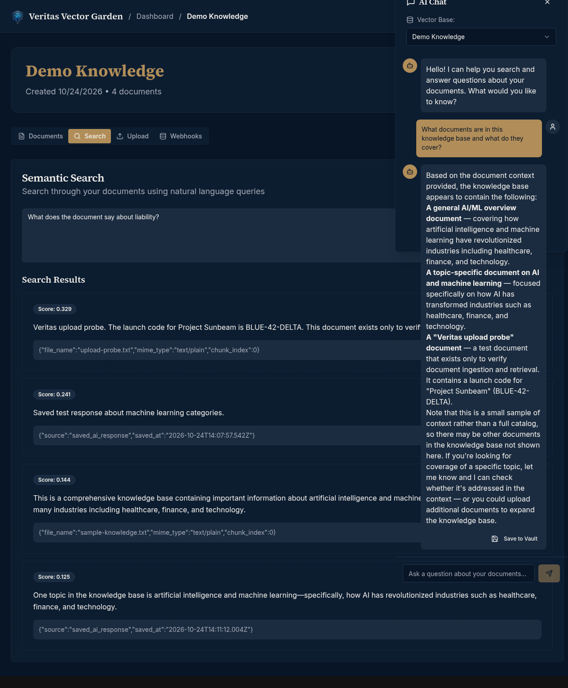
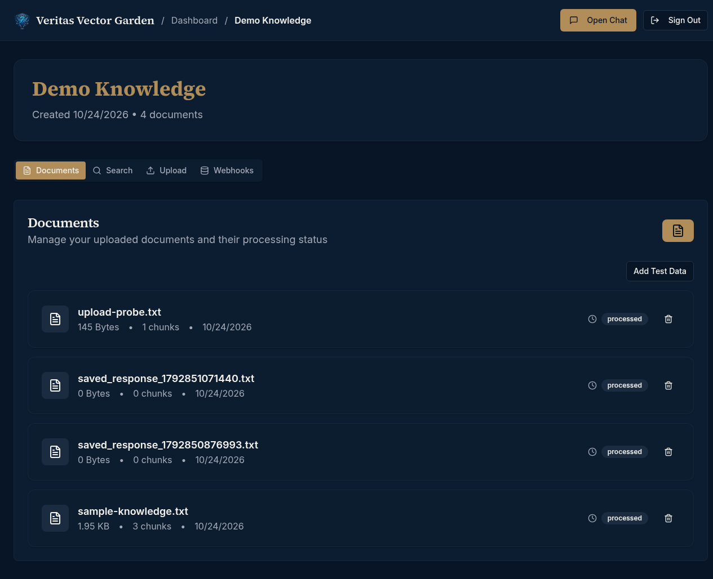
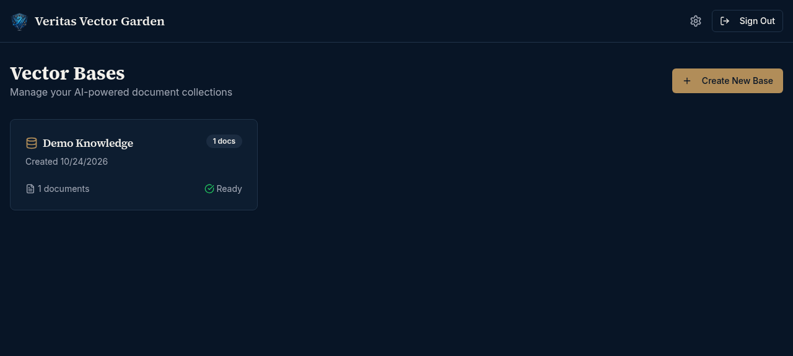
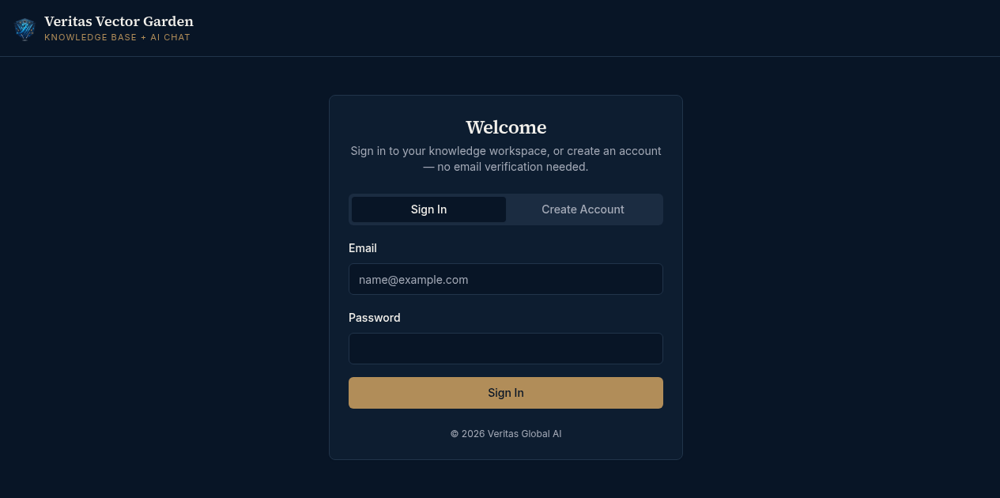
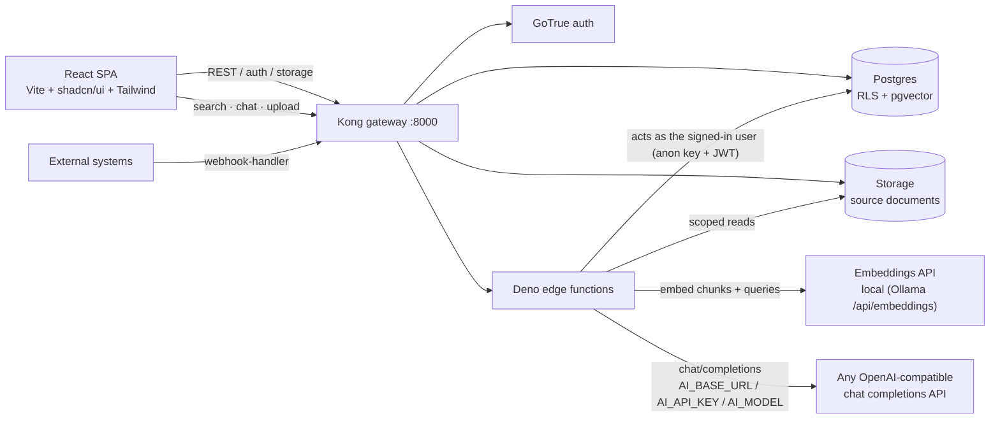

# Veritas Vector Garden

**Your own knowledge base, searchable in natural language and answerable by AI.**
A [Veritas Global AI](https://veritasglobalai.com) product.



---

## What it is

Veritas Vector Garden is a retrieval-augmented knowledge base: create **Vector Bases** (document
collections), upload your files, and the platform chunks and embeds them automatically. From then
on you can:

- **search** the collection in natural language and get scored, sourced chunks back,
- **chat** with an AI assistant that answers *from your documents* — not from the open internet,
- **save** good answers to a persistent vault,
- **push documents in from other systems** over webhooks and query the same API.

Everything runs on self-hosted infrastructure: Postgres + GoTrue + Storage + Deno edge functions,
with embeddings computed locally and the LLM called through a server-side, OpenAI-compatible
gateway. **No API key ever ships in the browser bundle.**

## Features

| Area | What you get |
| --- | --- |
| **Vector Bases** | Isolated document collections with status tracking (Processing → Ready), per-base management |
| **Document ingestion** | Upload files → automatic chunking + vector embeddings in real time |
| **Semantic search** | Natural-language queries over the base, returning ranked chunks with similarity scores and source metadata |
| **AI chat with context** | Ask questions in plain language; answers are grounded in retrieved document context, with **Save to Vault** |
| **Answer vault** | Persist useful AI answers alongside your documents (`save-to-vault`) |
| **Webhooks & API** | Push documents from external systems via `webhook-handler`; `search` and `chat` are callable as functions |
| **Auth & isolation** | Email/password sign-in, per-user data isolation enforced by Postgres row-level security |

## Screenshots

| Knowledge base | Semantic search + AI chat |
| --- | --- |
|  |  |

| Dashboard | Sign in |
| --- | --- |
|  |  |

## Architecture



Edge functions (`supabase/functions/`):

| Function | Role |
| --- | --- |
| `process-document` | Chunk + embed uploaded documents into vectors |
| `search` | Embed the query, rank chunks by similarity, return scored results |
| `chat` | Retrieve relevant chunks, then answer via an OpenAI-compatible completions API |
| `save-to-vault` | Persist an AI answer to the vault |
| `webhook-handler` | Ingest documents pushed from external systems |
| `create-test-data` | Seed a demo base (development helper) |

## Tech stack

- **Frontend** — Vite · React 18 · TypeScript · shadcn/ui · Tailwind CSS · React Router · TanStack Query
- **Backend** — self-hosted Supabase (Postgres · GoTrue · PostgREST · Storage · Kong · Deno edge functions)
- **Vectors** — Postgres vector storage with local embedding generation (`EMBEDDINGS_BASE_URL`)
- **AI** — any OpenAI-compatible chat completions endpoint (DeepSeek on the reference deployment)

## Self-hosted backend

Everything needed to stand up the backend lives in [`supabase/`](supabase/):

```
supabase/
├── selfhost/
│   ├── schema.sql        # idempotent DDL for the self-hosted stack
│   └── README.md         # runbook
├── migrations/           # full schema history (vector bases, chunks, vault, RLS)
└── functions/            # chat, search, process-document, save-to-vault,
                          # webhook-handler, create-test-data
```

Deploy the edge functions by copying `supabase/functions/*` into the Supabase functions root.
Configure the AI and embedding providers on the functions container (server-side only):

```bash
AI_BASE_URL=https://api.deepseek.com/v1    # any OpenAI-compatible endpoint
AI_API_KEY=<your key>                      # never in the bundle
AI_MODEL=deepseek-chat
EMBEDDINGS_BASE_URL=http://localhost:11434 # Ollama-compatible /api/embeddings
```

## Security & privacy

- **Row-level security everywhere** — vector bases, documents, chunks and vault entries are scoped
  to `auth.uid()`.
- **Edge functions act as the signed-in user** — anon key + forwarded JWT, so Postgres authorises
  every read and write; there is no service-role key in code.
- **No secrets in the client** — the SPA bundle contains only the public anon key. LLM and
  embeddings credentials live exclusively in function environment variables.
- **LAN-safe UUIDs** — `crypto.randomUUID()` (undefined on plain-HTTP origins) is replaced by a
  secure-context-safe helper everywhere, so chat and upload work on `http://<lan-ip>` too.

## Getting started

Prerequisites: Node.js 18+ and npm.

```bash
git clone https://github.com/Aimotive-agent/vector-garden-ai.git
cd vector-garden-ai
npm install
npm run dev
```

The Supabase client defaults to the self-hosted stack at `http://192.168.1.42:8000`. Point it
elsewhere at build time:

```bash
VITE_SUPABASE_URL=http://your-supabase:8000 \
VITE_SUPABASE_PUBLISHABLE_KEY=<anon key> \
npm run build
```

## Deployment

The repository ships [`server.cjs`](server.cjs), a zero-dependency static server with SPA
fallback, used by the OpenShip platform (`productionMode: host`):

```bash
npm run build
PORT=3152 node server.cjs   # serves ./dist on 0.0.0.0:$PORT
```

Reference deployment: OpenShip project `proj_9WnrSLSHQTC-z7wb`, port **3152** on the Veritas
homelab (auto-deploy off; deploys are triggered manually). External exposure is handled by the
operator's own reverse tunnel — nothing in this repo manages tunnels or DNS.

## Project structure

```
├── src/
│   ├── pages/             # landing, auth, dashboard, base detail, docs, settings
│   ├── components/        # chat panel, document list, search, upload, webhooks, shadcn ui/
│   ├── hooks/             # useAuth, data hooks
│   ├── integrations/      # supabase client + generated types
│   └── utils/uuid.ts      # secure-context-safe UUID
├── supabase/              # migrations, self-hosted schema, edge functions
├── docs/screenshots/      # README screenshots (live app)
└── server.cjs             # static SPA server for production
```

## Status & roadmap

Done: dark navy/gold Veritas theme · self-hosted Supabase backend · real RAG pipeline (ingestion →
embeddings → semantic search → grounded chat) · vault · webhooks · LAN-safe builds · OpenShip
deployment.

Planned: multi-format document parsing (PDF/DOCX depth), base sharing and roles, hybrid
keyword + vector ranking, webhook delivery receipts.

## Disclaimer

Veritas Vector Garden is a research and retrieval tool. AI answers are generated from your
uploaded context and may be incomplete or wrong — verify important information against the
source documents.

---

<p align="center">
  <b>© 2026 Veritas Global AI</b><br/>
  <a href="https://veritasglobalai.com">veritasglobalai.com</a>
</p>
